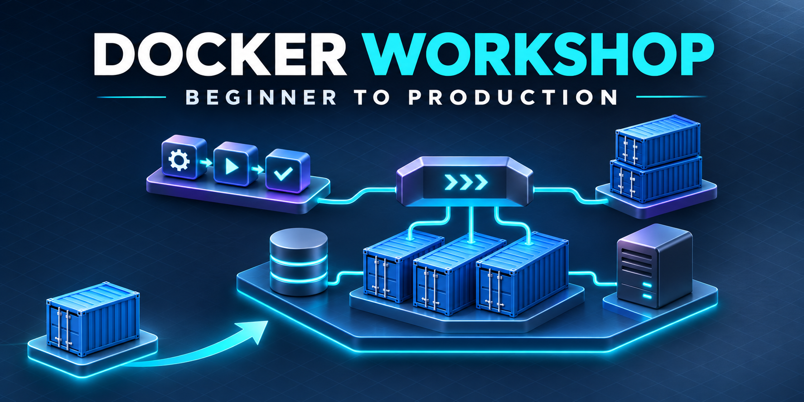

<p align="center" style="border-radius: 40px; overflow: hidden">
  
</p>

<h1 align="center">Docker Workshop</h1>

<p align="center">
  <strong>เรียนรู้ Docker จากศูนย์สู่การ Deploy ระบบ Production จริง</strong><br>
  ผ่าน Workshop ที่เชื่อมโยง Node.js, ASP.NET Core, PostgreSQL, SQL Server, Nginx และ Ubuntu Server
</p>

<p align="center">
  <a href="#about">เกี่ยวกับหลักสูตร</a> •
  <a href="#roadmap">Roadmap</a> •
  <a href="#getting-started">เริ่มต้นใช้งาน</a> •
  <a href="#repository-structure">โครงสร้างโปรเจกต์</a>
</p>

---

<a id="about"></a>

## 📘 เกี่ยวกับหลักสูตร

Repository นี้เป็นหลักสูตร Docker แบบ **Workshop-driven** เน้นการลงมือทำมากกว่าการท่องจำ เริ่มจาก Container เดี่ยวและค่อย ๆ เพิ่ม Network, Volume, Configuration, Database, Reverse Proxy, Security และ Deployment จนสามารถออกแบบ Production Stack ได้ด้วยตัวเอง

เมื่อเรียนครบ Roadmap คุณควรตอบคำถามเหล่านี้ได้:

- Application ควร Dockerize อย่างไร
- Service ใดควรแยกเป็นคนละ Container
- Container ควรสื่อสารกันผ่าน Network แบบไหน
- ข้อมูลและ Configuration ควรเก็บไว้ที่ใด
- จะ Build, Deploy, Monitor และ Debug ระบบอย่างไร
- จะลดขนาด Image และเพิ่มความปลอดภัยก่อนขึ้น Production อย่างไร

> [!NOTE]
> เนื้อหาถูกออกแบบให้เรียนตามลำดับ เพราะแต่ละ Workshop จะนำแนวคิดจากบทก่อนหน้ามาประกอบเป็นระบบที่ใหญ่ขึ้น

## 🎯 Learning Outcomes

เมื่อจบหลักสูตร คุณจะสามารถ:

- สร้างและจัดการ Docker Image กับ Container
- เขียน Dockerfile สำหรับ Node.js และ ASP.NET Core
- ออกแบบ Network และ Persistent Storage สำหรับระบบหลาย Service
- จัดการ Environment Variables และ Secrets
- ใช้ Docker Compose ดูแล Application Stack
- เชื่อมต่อ PostgreSQL และ SQL Server ภายใน Container Network
- วาง Nginx เป็น Reverse Proxy หน้า Application
- ใช้ Multi-stage Build เพื่อสร้าง Production Image
- ตรวจสอบ Health, Logs, Resource Usage และแก้ปัญหา Container
- Push Image ขึ้น Registry และ Deploy บน Ubuntu Server
- ต่อ CI/CD Pipeline ตั้งแต่ Git ไปจนถึง Deployment

<a id="roadmap"></a>

## 🗺️ Roadmap

Roadmap ฉบับเต็มประกอบด้วย **20 Workshops และ 1 Final Project** แบ่งเป็น 5 ระยะ:

### Phase 1 — Docker Foundations

| Workshop | หัวข้อ | สิ่งที่จะเรียนรู้ | สถานะ |
|:---:|---|---|:---:|
| [01](./workshop01-basic/README.md) | Docker Basics | Image, Container, Docker Engine และ Registry | ✅ พร้อมเรียน |
| [02](./workshop02-cli_logs/README.md) | Docker CLI | `run`, `ps`, `stop`, `rm`, `logs` และ `exec` | ✅ พร้อมเรียน |
| [03](./workshop03-port_mapping/README.md) | Images & Port Mapping | Image inspection, Layer และการเชื่อม Port | ✅ พร้อมเรียน |
| [04](./workshop04-dockerfile/README.md) | Dockerfile | สร้าง Custom Image และเข้าใจ Build Context | ✅ พร้อมเรียน |

### Phase 2 — Containerized Applications

| Workshop | หัวข้อ | สิ่งที่จะเรียนรู้ | สถานะ |
|:---:|---|---|:---:|
| [05](./workshop05-node/README.md) | Node.js + Docker | Dockerize Express API | ✅ พร้อมเรียน |
| [06](./workshop06-network/README.md) | Port & Network | ให้ Container สื่อสารกันผ่าน Docker DNS | ✅ พร้อมเรียน |
| [07](./workshop07-volume_persistant_data/README.md) | Volume | Named Volume, Bind Mount และ Persistent Data | ✅ พร้อมเรียน |
| [08](./workshop08-env/README.md) | Environment | `.env`, Environment Variables และ Configuration | ✅ พร้อมเรียน |
| [09](./workshop09-compose/README.md) | Docker Compose | จัดการหลาย Container ด้วยคำสั่งเดียว | ✅ พร้อมเรียน |
| [10](./workshop10-postgres/README.md) | Node.js + PostgreSQL | API, Database, Initialization และ Healthcheck | ✅ พร้อมเรียน |

> **Bonus Lab:** [Workshop 08B — Environment Practice](./workshop08b-env/) สำหรับทดลอง Development Workflow เพิ่มเติม

### Phase 3 — Production Application Stack

| Workshop | หัวข้อ | สิ่งที่จะทำ | สถานะ |
|:---:|---|---|:---:|
| 11 | ASP.NET Core | Dockerize .NET MVC และ Web API | 🧭 ตาม Roadmap |
| 12 | SQL Server | เชื่อมต่อ .NET กับ SQL Server Containers | 🧭 ตาม Roadmap |
| 13 | Nginx | วาง Reverse Proxy หน้า Application | 🧭 ตาม Roadmap |
| 14 | Production Dockerfile | ใช้ Multi-stage Build และลดขนาด Image | 🧭 ตาม Roadmap |
| 15 | Health Check | ตรวจ Readiness และสถานะของ Service | 🧭 ตาม Roadmap |

### Phase 4 — Operations & Security

| Workshop | หัวข้อ | สิ่งที่จะทำ | สถานะ |
|:---:|---|---|:---:|
| 16 | Logging & Debug | ใช้ `logs`, `inspect`, `stats` และ `exec` แก้ปัญหา | 🧭 ตาม Roadmap |
| 17 | Security | ใช้ Non-root User, Secrets และ Image Hygiene | 🧭 ตาม Roadmap |
| 18 | Docker Registry | ใช้ Docker Hub และ Private Registry | 🧭 ตาม Roadmap |

### Phase 5 — Deployment & Automation

| Workshop | หัวข้อ | สิ่งที่จะทำ | สถานะ |
|:---:|---|---|:---:|
| 19 | Ubuntu Server | Deploy Application Stack บน Linux Server | 🧭 ตาม Roadmap |
| 20 | CI/CD | ทำ Pipeline จาก Git → Build → Deploy | 🧭 ตาม Roadmap |
| **Final** | **Production Stack** | **Nginx + API + Database + Compose + Deployment** | 🏁 Capstone |

```text
Foundations
    │
    ▼
Containerized Applications
    │
    ▼
Production Application Stack
    │
    ▼
Operations & Security
    │
    ▼
Deployment & CI/CD
    │
    ▼
Final Project: Production Stack
```

## 🧱 Final Project Architecture

ปลายทางของหลักสูตรคือการประกอบแนวคิดทั้งหมดให้เป็น Production Stack:

```text
                         Internet
                            │
                            ▼
                    ┌───────────────┐
                    │     Nginx     │
                    │ Reverse Proxy │
                    └───────┬───────┘
                            │
                  ┌─────────┴─────────┐
                  ▼                   ▼
          ┌───────────────┐   ┌───────────────┐
          │  Node.js API  │   │ ASP.NET Core  │
          └───────┬───────┘   └───────┬───────┘
                  │                   │
                  └─────────┬─────────┘
                            ▼
              ┌─────────────────────────┐
              │ PostgreSQL / SQL Server │
              └────────────┬────────────┘
                           │
                           ▼
                     Named Volumes
```

ระบบจะถูก Build เป็น Production Images, จัดการด้วย Docker Compose, ส่งขึ้น Registry และ Deploy บน Ubuntu Server ผ่าน CI/CD Pipeline

## ✅ Prerequisites

| เครื่องมือ | ใช้สำหรับ |
|---|---|
| Docker Desktop หรือ Docker Engine | Build และ Run Container |
| Docker Compose v2 | จัดการ Multi-container Stack |
| Git | จัดการ Source Code และใช้ใน CI/CD |
| Terminal | PowerShell, Command Prompt หรือ Bash |
| Code Editor | แนะนำ Visual Studio Code |
| Node.js / .NET SDK | ทดสอบ Application นอก Container ในบาง Workshop |

ตรวจสอบ Environment ก่อนเริ่ม:

```bash
docker --version
docker compose version
git --version
docker run --rm hello-world
```

<a id="getting-started"></a>

## 🚀 เริ่มต้นใช้งาน

1. เริ่มจาก [Workshop 01](./workshop01-basic/README.md)
2. อ่านเป้าหมายและ Architecture ของ Workshop
3. ทำคำสั่งตามลำดับและสังเกตผลลัพธ์
4. ทดลอง Mini Challenge ก่อนข้ามไปบทถัดไป
5. ใช้ Logs และคำสั่งตรวจสอบเพื่ออธิบายสิ่งที่เกิดขึ้น

ตัวอย่างการเริ่ม Workshop:

```powershell
cd workshop01-basic
Get-Content README.md
```

ตัวอย่าง Workshop ที่ใช้ Docker Compose:

```bash
cd workshop10-postgres
docker compose config
docker compose up --build
```

<a id="repository-structure"></a>

## 📁 โครงสร้าง Repository

```text
docker-workshop/
├── assets/                            # ภาพและสื่อประกอบ Repository
├── workshop01-basic/                  # Docker foundations
├── workshop02-cli_logs/               # CLI, logs และ container inspection
├── workshop03-port_mapping/           # Image และ port mapping
├── workshop04-dockerfile/             # Custom image ด้วย Dockerfile
├── workshop05-node/                   # Node.js API
├── workshop06-network/                # Container networking
├── workshop07-volume_persistant_data/ # Persistent storage
├── workshop08-env/                    # Configuration และ environment
├── workshop08b-env/                   # Bonus practice
├── workshop09-compose/                # Multi-container Compose
├── workshop10-postgres/               # Node.js + PostgreSQL
├── context.md                         # Course direction และ full roadmap
└── README.md                          # Project overview
```

## 🧰 Command Reference

| คำสั่ง | ใช้ทำอะไร |
|---|---|
| `docker ps` | ดู Container ที่กำลังทำงาน |
| `docker ps -a` | ดู Container ทั้งหมด |
| `docker images` | ดู Image ในเครื่อง |
| `docker logs <container>` | ดู Logs ของ Container |
| `docker exec -it <container> sh` | เปิด Shell ภายใน Container |
| `docker inspect <target>` | ดู Configuration และ Runtime Metadata |
| `docker stats` | ดู CPU, Memory และ Network Usage |
| `docker build -t <name> .` | สร้าง Image จาก Dockerfile |
| `docker compose up -d` | เริ่ม Compose Stack แบบ Background |
| `docker compose down` | หยุดและลบ Container กับ Network |

> [!CAUTION]
> `docker compose down -v` จะลบ Named Volume และข้อมูลภายใน Volume ควรตรวจสอบ Project และข้อมูลให้แน่ใจก่อนใช้ โดยเฉพาะ Stack ที่มี Database

## 🧠 Core Concepts

| แนวคิด | สิ่งที่ต้องจำ |
|---|---|
| Image | Template แบบ Read-only สำหรับสร้าง Container |
| Container | Runtime Instance ที่สร้างจาก Image |
| `localhost` ใน Container | หมายถึง Container ตัวนั้นเอง |
| Compose Service Name | DNS Hostname สำหรับเชื่อมต่อระหว่าง Container |
| Named Volume | Storage ที่มี Lifecycle แยกจาก Container |
| Environment Variable | Configuration ที่ส่งเข้า Application ตอน Runtime |
| Healthcheck | ตรวจว่า Service พร้อมใช้งานจริงหรือไม่ |
| Multi-stage Build | แยก Build Tools ออกจาก Production Runtime Image |
| Container Running | Process เริ่มแล้ว แต่อาจยังไม่พร้อมให้บริการ |
| Application Ready | Application พร้อมรับ Request หรือ Connection |

---

<p align="center">
  เริ่มจาก <strong><a href="./workshop01-basic/README.md">Workshop 01: Docker Basics</a></strong><br>
  แล้วค่อย ๆ พัฒนาจาก Container เดี่ยวไปสู่ Production Stack ที่ Build, Deploy และ Debug ได้จริง
</p>
