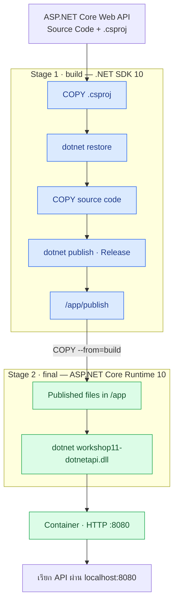
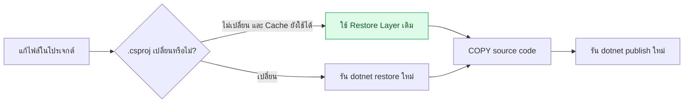
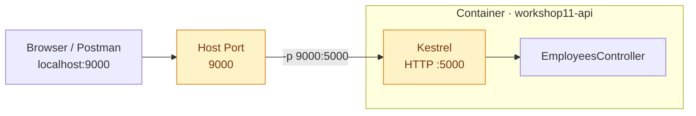
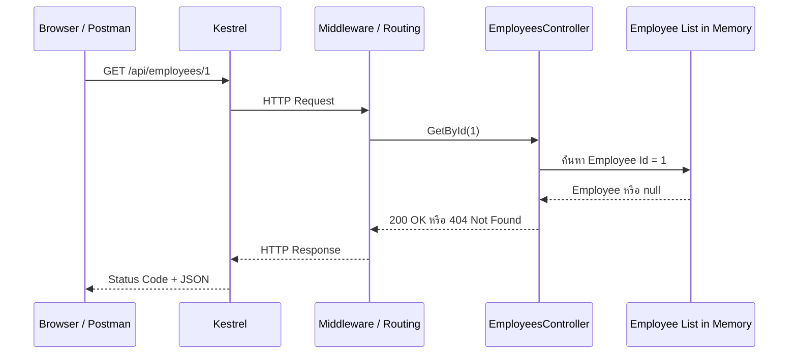
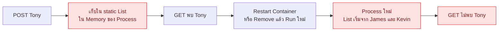

# 🐳 Workshop 11 — ASP.NET Core .NET 10 + Docker

> เรียนรู้ **Multi-stage Build** ผ่าน Employee API แบบ Controllers: ใช้ .NET SDK สร้างแอป แล้วนำเฉพาะไฟล์ที่ publish ไปใส่ใน ASP.NET Core Runtime Image

จาก Workshop ก่อนที่ใช้ Node.js รอบนี้เราจะนำพื้นฐาน Docker เดิมมาใช้กับ C# และ ASP.NET Core โดยยังเก็บข้อมูลใน Memory เพื่อโฟกัสที่การทำ Container ก่อนต่อยอดไป Database ใน Workshop 12

| สิ่งที่จะได้ฝึก | รายละเอียด |
| --- | --- |
| **Application** | ASP.NET Core Web API แบบ Controllers บน .NET 10 |
| **Build** | `dotnet restore` → `dotnet publish` ใน SDK Stage |
| **Runtime** | รัน Published DLL ด้วย ASP.NET Core Runtime |
| **Docker** | Layer Cache, Port Mapping, Logs และ Environment Variables |
| **ข้อมูลตัวอย่าง** | Employee ใน `static List<Employee>` |

<a id="contents"></a>

## 📑 สารบัญ

- [เตรียมตัวและภาพรวม](#overview)
- [ส่วนที่ 1 · สร้างและทดสอบ API — ขั้นตอน 1–3](#api)
- [ส่วนที่ 2 · เข้าใจ Multi-stage Build — ขั้นตอน 4–5](#multi-stage)
- [ส่วนที่ 3 · แกะ Dockerfile ทีละส่วน — ขั้นตอน 6–17](#dockerfile)
- [ส่วนที่ 4 · Build, Run และตรวจสอบ — ขั้นตอน 18–23](#run)
- [ส่วนที่ 5 · ตั้งค่า Runtime — ขั้นตอน 24–27](#configuration)
- [ส่วนที่ 6 · ตรวจสอบ Image และทบทวน — ขั้นตอน 28–30](#review)
- [Mini Challenge 11 · POST Employee และทดลองข้อมูลใน Memory](#challenge)
- [Checklist และ Workshop ถัดไป](#checklist)

---

<a id="overview"></a>

## 🧭 เตรียมตัวและภาพรวม

เตรียม Docker ให้พร้อมใช้งานในโหมด **Linux containers** และติดตั้ง **.NET SDK 10** หากต้องการทดสอบด้วย `dotnet run` บนเครื่อง

คำสั่งฝั่งเครื่องในเอกสารนี้ใช้ **PowerShell** และเริ่มจากโฟลเดอร์ `docker-workshop` เว้นแต่จะระบุเป็นอย่างอื่น

```powershell
docker version
dotnet --list-sdks
```

### ภาพรวม: จาก Source Code ไปเป็น Container



**อ่านภาพ:** SDK Stage สร้างไฟล์ใน `/app/publish` แล้ว Runtime Stage รับไฟล์เหล่านั้นผ่าน `COPY --from=build` เพื่อสร้าง Final Image

> [!TIP]
> เปิด README บน GitHub หรือ Markdown Preview ที่รองรับ Mermaid เพื่อดูแผนภาพ

---

<a id="api"></a>

## 🛠️ ส่วนที่ 1 · สร้างและทดสอบ API

### 1. สร้าง Project

**หากใช้โปรเจกต์ใน Repository นี้** ให้เข้าโฟลเดอร์แล้วทดสอบได้เลย:

```powershell
cd workshop11-dotnetapi
dotnet run --launch-profile http
```

**หากเริ่มสร้างใหม่เอง** ให้รันจากโฟลเดอร์ `docker-workshop` ที่ยังไม่มีโฟลเดอร์ชื่อนี้:

```powershell
dotnet new webapi --use-controllers -n workshop11-dotnetapi -f net10.0
cd workshop11-dotnetapi
dotnet run
```

`--use-controllers` ใช้สร้าง Web API แบบ Controllers จากนั้นเปิด URL ที่ Console แจ้งเพื่อทดสอบแอป

> [!IMPORTANT]
> ให้แอปรันบนเครื่องได้ก่อนเริ่ม Docker หาก `dotnet run` ยังมี Error ให้แก้ฝั่ง Application ก่อน

โครงสร้างไฟล์หลักของโปรเจกต์นี้:

```text
workshop11-dotnetapi/
├── Controllers/
│   └── EmployeesController.cs
├── Dtos/
│   └── Employee/
│       └── CreateEmployeeRequest.cs
├── Models/
│   └── Employee.cs
├── Properties/
│   └── launchSettings.json
├── Program.cs
├── appsettings.json
├── workshop11-dotnetapi.csproj
├── Dockerfile
└── .dockerignore
```

### 2. สร้าง Employee Model

ไฟล์ [Models/Employee.cs](Models/Employee.cs):

```csharp
namespace workshop11_dotnetapi.Models;

public class Employee
{
    public int Id { get; set; }
    public string EmployeeCode { get; set; } = string.Empty;
    public string Name { get; set; } = string.Empty;
    public string Department { get; set; } = string.Empty;
}
```

รอบนี้ใช้ข้อมูลใน Memory ส่วน Database จะต่อยอดด้วย ASP.NET Core + SQL Server + Docker Compose ใน Workshop 12

### 3. สร้าง EmployeesController

ตัวอย่างเริ่มต้นสำหรับ GET ใน [Controllers/EmployeesController.cs](Controllers/EmployeesController.cs):

```csharp
using Microsoft.AspNetCore.Mvc;
using workshop11_dotnetapi.Models;

namespace workshop11_dotnetapi.Controllers;

[ApiController]
[Route("api/[controller]")]
public class EmployeesController : ControllerBase
{
    private static readonly List<Employee> Employees =
    [
        new Employee
        {
            Id = 1,
            EmployeeCode = "260001",
            Name = "James",
            Department = "IT"
        },
        new Employee
        {
            Id = 2,
            EmployeeCode = "260002",
            Name = "Kevin",
            Department = "Engineering"
        }
    ];

    [HttpGet]
    public ActionResult<IEnumerable<Employee>> GetAll() => Ok(Employees);

    [HttpGet("{id:int}")]
    public ActionResult<Employee> GetById(int id)
    {
        var employee = Employees.FirstOrDefault(x => x.Id == id);

        if (employee is null)
        {
            return NotFound(new { message = "Employee not found" });
        }

        return Ok(employee);
    }
}
```

> [!NOTE]
> Controller ใน Repository มี `POST` และ DTO เพิ่มไว้แล้ว ตัวอย่างด้านบนแสดงเฉพาะ GET สำหรับเริ่มเรียน ส่วน POST ใช้ทดสอบใน [Mini Challenge](#challenge)

ตรวจว่า [Program.cs](Program.cs) ลงทะเบียนและ Map Controllers ไว้:

```csharp
builder.Services.AddControllers();

// หลัง builder.Build()
app.MapControllers();
```

สำหรับ HTTP Profile ใน Repository นี้ เปิด [http://localhost:5197/api/employees](http://localhost:5197/api/employees) หรือใช้ Port ที่ Console แจ้งหากสร้างโปรเจกต์ใหม่ ควรได้ JSON:

```json
[
  {
    "id": 1,
    "employeeCode": "260001",
    "name": "James",
    "department": "IT"
  },
  {
    "id": 2,
    "employeeCode": "260002",
    "name": "Kevin",
    "department": "Engineering"
  }
]
```

กด `Ctrl+C` เพื่อหยุดแอปเมื่อทดสอบเสร็จ

---

<a id="multi-stage"></a>

## 🧱 ส่วนที่ 2 · เข้าใจ Multi-stage Build

### 4. ปัญหาของการใช้ SDK Image เป็น Runtime

ตัวอย่าง Dockerfile แบบ Stage เดียว:

```dockerfile
FROM mcr.microsoft.com/dotnet/sdk:10.0
WORKDIR /app
COPY . .
RUN dotnet restore
RUN dotnet build
CMD ["dotnet", "run"]
```

Image นี้มีทั้ง SDK, Compiler, Build Tools, NuGet Tooling และ Source Code ติดไปด้วย ขณะที่ตอนรันแอปที่ Publish แล้วต้องใช้ ASP.NET Core Runtime และ Published Files

เปรียบเหมือนการพัฒนาโปรแกรมที่ต้องใช้ SDK และ Compiler แต่เมื่อนำโปรแกรมไปให้ผู้ใช้เปิด ก็ส่งเฉพาะสิ่งที่จำเป็นต่อการรันได้

### 5. เปรียบเทียบ SDK กับ ASP.NET Core Runtime

| หัวข้อ | Build Stage | Runtime Stage |
| --- | --- | --- |
| Base Image | `mcr.microsoft.com/dotnet/sdk:10.0` | `mcr.microsoft.com/dotnet/aspnet:10.0` |
| หน้าที่ | Restore, Build, Test และ Publish | รันแอปที่ Publish แล้ว |
| SDK / Compiler | มี | ไม่มี SDK |
| ไฟล์ของแอป | Source Code และ Build Artifacts | Published Files ที่ Copy เข้ามา |
| ใช้เป็น Final Image ใน Workshop นี้ | — | ✅ |

Microsoft ใช้รูปแบบแยก SDK และ Runtime ในตัวอย่าง [Run an ASP.NET Core app in Docker containers](https://learn.microsoft.com/en-us/aspnet/core/host-and-deploy/docker/building-net-docker-images?view=aspnetcore-10.0)

---

<a id="dockerfile"></a>

## 📦 ส่วนที่ 3 · แกะ Dockerfile ทีละส่วน

### 6. สร้าง Dockerfile

สร้าง [Dockerfile](Dockerfile) ที่เดียวกับ `workshop11-dotnetapi.csproj`:

```dockerfile
# Stage 1: Build ด้วย .NET SDK
FROM mcr.microsoft.com/dotnet/sdk:10.0 AS build

WORKDIR /src

COPY ["workshop11-dotnetapi.csproj", "./"]
RUN dotnet restore

COPY . .
RUN dotnet publish "workshop11-dotnetapi.csproj" \
    -c Release \
    -o /app/publish \
    --no-restore

# Stage 2: รันด้วย ASP.NET Core Runtime
FROM mcr.microsoft.com/dotnet/aspnet:10.0 AS final

WORKDIR /app
COPY --from=build /app/publish .

EXPOSE 8080
ENTRYPOINT ["dotnet", "workshop11-dotnetapi.dll"]
```

ชื่อ `.csproj` และ `.dll` ต้องตรงกับโปรเจกต์จริง รวมถึงตัวพิมพ์เล็ก–ใหญ่เมื่อนำไปใช้ใน Linux Container

### 7. Stage แรก — Build

```dockerfile
FROM mcr.microsoft.com/dotnet/sdk:10.0 AS build
WORKDIR /src
```

- `FROM` เลือก .NET SDK 10 เป็น Base Image
- `AS build` ตั้งชื่อ Stage เพื่อนำไปอ้างอิงใน `COPY --from=build`
- `WORKDIR /src` กำหนดโฟลเดอร์ทำงานภายใน Stage นี้

### 8. ทำไม COPY .csproj ก่อน Source Code

```dockerfile
COPY ["workshop11-dotnetapi.csproj", "./"]
RUN dotnet restore

COPY . .
```

การแยกไฟล์โปรเจกต์และ Restore ออกจาก Source Code ช่วยให้ Docker ใช้ Layer Cache ได้เมื่อแก้เฉพาะไฟล์ `.cs` โดยไฟล์โปรเจกต์และ Layer ก่อนหน้าไม่เปลี่ยน ตามตัวอย่าง [การแยก Restore Layer ของ Microsoft](https://learn.microsoft.com/en-us/aspnet/core/host-and-deploy/docker/building-net-docker-images?view=aspnetcore-10.0#the-dockerfile)



เปรียบเทียบแนวคิดกับ Node.js:

| แนวคิด | Node.js | .NET |
| --- | --- | --- |
| ประกาศ Dependencies | `package.json` และ Lockfile | `.csproj` / `PackageReference` |
| เตรียม Dependencies | `npm ci` | `dotnet restore` |
| Source Code | `server.js` และไฟล์อื่น ๆ | `*.cs` |

### 9. dotnet restore ทำอะไร

```dockerfile
RUN dotnet restore
```

อ่านโปรเจกต์และ `PackageReference` เพื่อ Resolve และดาวน์โหลด NuGet Dependencies ที่จำเป็น ขั้นตอนนี้คล้ายการเตรียม Dependencies ด้วย `npm ci` ใน Workshop ฝั่ง Node.js

### 10. COPY Source Code

```dockerfile
COPY . .
```

Copy ไฟล์จาก **Build Context** มายัง `/src` โดยกรองไฟล์ที่ระบุใน `.dockerignore` ออก ตอนนี้ Stage มีทั้ง Controllers, Models, DTOs, `Program.cs`, `appsettings.json` และไฟล์โปรเจกต์พร้อมสำหรับ Publish

### 11. dotnet publish

```dockerfile
RUN dotnet publish "workshop11-dotnetapi.csproj" \
    -c Release \
    -o /app/publish \
    --no-restore
```

| Option | ความหมาย |
| --- | --- |
| `-c Release` | ใช้ Build Configuration แบบ Release |
| `-o /app/publish` | วาง Published Output ใน `/app/publish` |
| `--no-restore` | ใช้ผล Restore ที่ทำไว้แล้ว |

`dotnet publish` ทำการ Build และเตรียมไฟล์ที่ใช้ Deploy จึงไม่ต้องเพิ่ม `dotnet build` แยกใน Dockerfile นี้ ตัวอย่าง Output:

```text
/app/publish/
├── workshop11-dotnetapi.dll
├── workshop11-dotnetapi.deps.json
├── workshop11-dotnetapi.runtimeconfig.json
├── appsettings.json
└── ...
```

### 12. Stage ที่สอง — Runtime

```dockerfile
FROM mcr.microsoft.com/dotnet/aspnet:10.0 AS final
WORKDIR /app
```

`FROM` บรรทัดนี้เริ่ม Stage ใหม่จาก ASP.NET Core Runtime Image โดยมี Filesystem ของตัวเอง แล้วกำหนดโฟลเดอร์ทำงานเป็น `/app`

### 13. COPY ข้าม Stage

```dockerfile
COPY --from=build /app/publish .
```

อ่านว่า **Copy ไฟล์จาก `/app/publish` ของ Stage ชื่อ `build` มาไว้ใน `/app` ของ Stage ปัจจุบัน** นี่คือจุดเชื่อมระหว่าง Build กับ Runtime ในแผนภาพด้านบน

### 14. Final Image มีอะไรบ้าง

Final Image ประกอบด้วย **ASP.NET Core Runtime + Published Files** ใน `/app` ส่วน SDK, Compiler และโฟลเดอร์ Source `/src` จาก Build Stage จะไม่ถูก Copy มาทั้งชุด

การนำเฉพาะไฟล์ที่จำเป็นมาใช้ช่วยลดขนาด Image และส่วนประกอบที่ต้องดูแลเมื่อเทียบกับการใช้ SDK Image รันแอป

### 15. ENTRYPOINT

```dockerfile
ENTRYPOINT ["dotnet", "workshop11-dotnetapi.dll"]
```

เมื่อ Container เริ่มทำงาน จะเรียก `dotnet workshop11-dotnetapi.dll` เพื่อเริ่ม ASP.NET Core และ Kestrel แนวคิดคล้าย `CMD ["npm", "start"]` ใน Workshop ก่อนที่กำหนด Process หลักของ Container

### 16. Port 8080

```dockerfile
EXPOSE 8080
```

ASP.NET Core Container Images ใช้ HTTP Port `8080` เป็นค่าเริ่มต้นตั้งแต่ .NET 8 และกำหนดค่าใหม่ผ่าน `ASPNETCORE_HTTP_PORTS` ได้ ดู [Default ASP.NET Core port changed to 8080](https://learn.microsoft.com/en-us/dotnet/core/compatibility/containers/8.0/aspnet-port)

> [!IMPORTANT]
> `EXPOSE` ระบุข้อมูล Port ของ Image การเปิดให้เครื่องเข้าถึงต้องใช้ `docker run -p HOST_PORT:CONTAINER_PORT` และแอปต้องฟังที่ Container Port นั้นด้วย

### 17. .dockerignore

ไฟล์ [.dockerignore](.dockerignore):

```dockerignore
bin/
obj/
.vs/
.vscode/
.git/
.gitignore

Dockerfile*
README.md
```

จุดสำคัญคือการตัด `bin/` และ `obj/` ที่ Build จากเครื่องออก เพื่อให้ Linux SDK Image Restore และ Publish เอง คล้ายกับการตัด `node_modules/` จากเครื่องแล้วติดตั้ง Dependencies ภายใน Container

---

<a id="run"></a>

## 🚀 ส่วนที่ 4 · Build, Run และตรวจสอบ

### 18. Build Image

รันจากโฟลเดอร์ `workshop11-dotnetapi`:

```powershell
docker build -t workshop11-api:1.0 .
docker images
```

`.` คือ Build Context ปัจจุบัน ระหว่าง Build ควรเห็นขั้นตอน COPY `.csproj`, Restore, COPY Source, Publish และ COPY ข้าม Stage จากนั้นมี Image ชื่อ `workshop11-api` พร้อม Tag `1.0`

### 19. Run Container

```powershell
docker run -d --name workshop11-api -p 8080:8080 workshop11-api:1.0
docker ps
```

| ส่วนของคำสั่ง | ความหมาย |
| --- | --- |
| `-d` | รันเบื้องหลัง |
| `--name workshop11-api` | ตั้งชื่อ Container |
| `-p 8080:8080` | ส่งต่อ Host Port 8080 ไป Container Port 8080 |
| `workshop11-api:1.0` | Image และ Tag ที่นำมารัน |

ใน `docker ps` ควรเห็น Port Mapping เช่น `0.0.0.0:8080->8080/tcp`

### 20. ทดสอบ API

เปิดผ่าน Browser, Postman หรือใช้ PowerShell:

```powershell
Invoke-RestMethod http://localhost:8080/api/employees
Invoke-RestMethod http://localhost:8080/api/employees/1
```

| Method | URL | ผลที่คาดหวัง |
| --- | --- | --- |
| GET | [http://localhost:8080/api/employees](http://localhost:8080/api/employees) | `200 OK` พร้อมรายการพนักงาน |
| GET | [http://localhost:8080/api/employees/1](http://localhost:8080/api/employees/1) | `200 OK` พร้อมข้อมูล James |
| GET | [http://localhost:8080/api/employees/999](http://localhost:8080/api/employees/999) | `404 Not Found` |

ตัวอย่าง Response ของ `/api/employees/1`:

```json
{
  "id": 1,
  "employeeCode": "260001",
  "name": "James",
  "department": "IT"
}
```

### 21. ดู Logs

```powershell
docker logs workshop11-api
docker logs -f workshop11-api
```

ตัวอย่างข้อความที่ควรพบ:

```text
Now listening on: http://[::]:8080
Application started.
Hosting environment: Production
```

Docker เก็บ Console Output ของแอป รวมถึง Logs จาก `ILogger` ที่ส่งออก Console ใช้ `-f` เพื่อติดตามต่อเนื่อง และกด `Ctrl+C` เพื่อออกจากการติดตาม

### 22. เข้า Container เพื่อตรวจสอบ Runtime

```powershell
docker exec -it workshop11-api bash
```

คำสั่งต่อไปนี้รัน **ภายใน Linux Container**:

```bash
pwd
ls
dotnet --list-sdks
dotnet --info
exit
```

สิ่งที่ควรสังเกต:

- `pwd` ได้ `/app`
- `ls` เห็น Published Files เช่น `workshop11-dotnetapi.dll`
- `dotnet --list-sdks` ไม่มี SDK แสดง เพราะใช้ Runtime Image
- `dotnet --info` แสดงข้อมูล Runtime Environment
- `exit` กลับมายัง Shell บนเครื่อง

### 23. Build Stage หายไปไหน

Build Stage ถูกใช้ระหว่าง `docker build` เพื่อสร้าง Artifacts และอาจมี Cache เก็บไว้สำหรับ Build ครั้งถัดไป ส่วน `docker run` จะรัน Container จาก **Final Image** โดยไม่มี SDK Stage อีกตัวรันคู่กัน

---

<a id="configuration"></a>

## ⚙️ ส่วนที่ 5 · ตั้งค่า Runtime

### 24. ทดสอบ Environment Variables

ลบ Container ตัวอย่างเดิม แล้วสร้างใหม่โดยเปลี่ยน Environment:

```powershell
docker rm -f workshop11-api
docker run -d --name workshop11-api -e ASPNETCORE_ENVIRONMENT=Development -p 8080:8080 workshop11-api:1.0
docker logs workshop11-api
```

Logs ควรแสดง `Hosting environment: Development` แทน `Production` แนวคิด Environment Variables จาก Workshop 08 จึงใช้กับ .NET ได้เช่นกัน

### 25. เปลี่ยน Port ของ ASP.NET Core

```powershell
docker rm -f workshop11-api
docker run -d --name workshop11-api -e ASPNETCORE_HTTP_PORTS=5000 -p 9000:5000 workshop11-api:1.0
```



เปิด [http://localhost:9000/api/employees](http://localhost:9000/api/employees)

| ตัวตั้งค่า | หน้าที่ |
| --- | --- |
| `ASPNETCORE_HTTP_PORTS=5000` | ให้แอปฟัง HTTP ที่ Port 5000 ใน Container |
| `-p 9000:5000` | ส่งต่อ Host Port 9000 ไป Container Port 5000 |

ฝั่ง Node.js เคยใช้ `PORT` ส่วนตัวอย่าง ASP.NET Core นี้ใช้ `ASPNETCORE_HTTP_PORTS` โดย Port ฝั่งขวาของ `-p` ต้องตรงกับ Port ที่แอปฟัง

### 26. launchSettings.json ใช้ตอนไหน

[Properties/launchSettings.json](Properties/launchSettings.json) เป็นการตั้งค่าสำหรับ Development Launch เช่น HTTP Profile ของโปรเจกต์นี้:

```json
{
  "applicationUrl": "http://localhost:5197"
}
```

เมื่อ Container ใช้ `ENTRYPOINT` เรียก Published DLL โดยตรง จะตั้งค่า Runtime ผ่าน Environment Variables เช่น `ASPNETCORE_HTTP_PORTS` และ `ASPNETCORE_ENVIRONMENT` แทนการเลือก Launch Profile ดู [Configuration in ASP.NET Core](https://learn.microsoft.com/en-us/aspnet/core/fundamentals/configuration/?view=aspnetcore-10.0)

### 27. ASP.NET Core Configuration กับ Environment

ตัวอย่างสำหรับต่อยอด Database ใน Workshop ถัดไป หากมี Configuration:

```json
{
  "ConnectionStrings": {
    "DefaultConnection": "..."
  }
}
```

สามารถส่งค่าผ่าน Docker Option:

```text
-e ConnectionStrings__DefaultConnection="Server=db;..."
```

แล้วอ่านใน C#:

```csharp
builder.Configuration.GetConnectionString("DefaultConnection");
```

`__` คือ Underscore สองตัว ใช้แทน `:` สำหรับ Key แบบลำดับชั้น เช่น `ConnectionStrings:DefaultConnection` ตาม [Environment Variables Configuration Provider](https://learn.microsoft.com/en-us/aspnet/core/fundamentals/configuration/?view=aspnetcore-10.0#non-prefixed-environment-variables)

---

<a id="review"></a>

## 🔎 ส่วนที่ 6 · ตรวจสอบ Image และทบทวน

### 28. ดู Image History และขนาด

```powershell
docker history workshop11-api:1.0
docker images
```

`docker history` แสดงประวัติ Layer ของ Final Image ส่วน SDK Layers ของ Build Stage จะไม่ถูกนำมารวมเป็น Runtime Filesystem ทั้งหมด

ลองเปรียบเทียบ `mcr.microsoft.com/dotnet/sdk:10.0`, `mcr.microsoft.com/dotnet/aspnet:10.0` และ `workshop11-api:1.0` หากมี Images เหล่านี้อยู่ในเครื่อง โดย SDK Image มักใหญ่กว่า Runtime Image

### 29. Base OS ของ .NET 10

Default Linux Tags ของ .NET 10 เช่น `sdk:10.0` และ `aspnet:10.0` ใช้ **Ubuntu 24.04 Noble** เป็นฐาน ตาม [Default .NET images use Ubuntu](https://learn.microsoft.com/en-us/dotnet/core/compatibility/containers/10.0/default-images-use-ubuntu)

หากเพิ่มการติดตั้ง OS Packages หรือใช้ Native Libraries ต้องตรวจสอบความเข้ากันได้กับ Base OS ด้วย

### 30. ลำดับสำคัญของ Dockerfile

กลับไปดู [Dockerfile ฉบับเต็มในขั้นตอน 6](#dockerfile) แล้วจำหน้าที่แต่ละช่วง:

| ลำดับ | คำสั่งหลัก | สิ่งที่ได้ |
| --- | --- | --- |
| 1 | `FROM .../sdk:10.0 AS build` | สภาพแวดล้อมสำหรับ Build |
| 2 | `COPY .csproj` → `dotnet restore` | Dependencies และ Restore Layer |
| 3 | `COPY . .` → `dotnet publish` | Published Files ใน `/app/publish` |
| 4 | `FROM .../aspnet:10.0 AS final` | Runtime Stage ใหม่ |
| 5 | `COPY --from=build /app/publish .` | แอปที่พร้อมรันใน `/app` |
| 6 | `ENTRYPOINT ["dotnet", "workshop11-dotnetapi.dll"]` | Process หลักของ Container |

> **SDK มีไว้สร้าง Application ส่วน Runtime มีไว้รัน Application**

Docker นำแอปไปทำงานใน Container ส่วนการรับ Request ของ ASP.NET Core ยังทำงานตาม Pipeline ของแอป ตัวอย่างใน Workshop นี้อ่านข้อมูลจาก List ภายใน Controller โดยตรง:



---

<a id="challenge"></a>

## 🧪 Mini Challenge 11 · POST Employee

สำหรับผู้ที่เริ่มเขียนเอง ให้เพิ่ม `POST /api/employees` เพื่อรับข้อมูล เพิ่มลง Static List แล้วตอบ `201 Created` ส่วนโปรเจกต์ใน Repository มี Endpoint นี้แล้ว สามารถทดลองและอ่านการใช้ `CreatedAtAction` ใน Controller ได้

Request Body:

```json
{
  "employeeCode": "260003",
  "name": "Tony",
  "department": "IT"
}
```

### ภารกิจ

1. ทดสอบ POST ด้วย `dotnet run` บนเครื่อง
2. Build Image เป็น `workshop11-api:2.0`
3. ลบ Container ตัวอย่างเดิม แล้ว Run Version 2.0
4. Map Port `9000:8080` โดยใช้ HTTP Port เริ่มต้นใน Container
5. POST Employee จากนั้น GET เพื่อตรวจว่ามี Tony
6. ดู Logs และเข้า Container เพื่อตรวจ `/app` กับ `dotnet --info`
7. ทดลอง Restart Container แล้ว GET อีกครั้งเพื่อสังเกตข้อมูลใน Memory

```powershell
docker build -t workshop11-api:2.0 .
docker rm -f workshop11-api
docker run -d --name workshop11-api -p 9000:8080 workshop11-api:2.0

$body = @{
    employeeCode = "260003"
    name = "Tony"
    department = "IT"
} | ConvertTo-Json

Invoke-RestMethod -Method Post -Uri http://localhost:9000/api/employees -ContentType "application/json" -Body $body
Invoke-RestMethod http://localhost:9000/api/employees

docker logs workshop11-api
docker exec workshop11-api ls /app
docker exec workshop11-api dotnet --info
```

ใน Postman ตรวจ Status ว่าเป็น `201 Created` และลอง GET พนักงานที่เพิ่งสร้างผ่าน URL ใน `Location` Header

> [!NOTE]
> Controller ใน Repository ตรวจ `EmployeeCode` ซ้ำ หาก POST รหัสเดิมซ้ำใน Process เดิมจะได้ `400 Bad Request` ให้เปลี่ยนรหัสหรือเริ่ม Container ใหม่ก่อนทดลองอีกครั้ง

### ทดลองวงจรชีวิตของข้อมูล



```powershell
docker restart workshop11-api
# รอจนแอปเริ่มฟัง Port อีกครั้ง แล้วเรียก GET
Invoke-RestMethod http://localhost:9000/api/employees
```

**สิ่งที่ต้องสังเกต:** Tony หายเมื่อ Process เริ่มใหม่ เพราะข้อมูลอยู่ใน Memory การทดลองนี้จึงเชื่อมไปสู่การใช้ Database และ Volume ใน Workshop ถัดไป

---

<a id="checklist"></a>

## ✅ ตรวจความเข้าใจหลัง Workshop 11

- [ ] อธิบายได้ว่า SDK Image และ ASP.NET Core Runtime Image ทำหน้าที่ต่างกันอย่างไร
- [ ] อธิบายได้ว่าทำไมแยก COPY `.csproj` และ Restore ก่อน Source Code
- [ ] เข้าใจว่า `dotnet publish` สร้างไฟล์พร้อม Deploy ใน `/app/publish`
- [ ] ใช้ `COPY --from=build` ส่ง Published Files ไป Runtime Stage ได้
- [ ] Build และ Run Image พร้อมเรียก GET / POST API ได้
- [ ] แยก Host Port, Container Port และ Port ที่ Kestrel ฟังได้
- [ ] ใช้ Logs, `docker exec` และ Environment Variables เพื่อตรวจสอบแอปได้
- [ ] อธิบายได้ว่าทำไมข้อมูลใน Static List หายเมื่อ Process เริ่มใหม่

### ⏭️ Workshop 12 — ASP.NET Core + SQL Server + Docker Compose

ต่อยอด API นี้ด้วย **EF Core + SQL Server Container + Connection String ผ่าน Environment Variable + Named Volume + Healthcheck** แล้วทดลองลบและสร้าง Database Container ใหม่โดยข้อมูลยังอยู่ใน Volume

[← Workshop 10 · PostgreSQL](../workshop10-postgres/README.md) · [กลับหน้าหลัก](../README.md) · [กลับสารบัญ](#contents)
